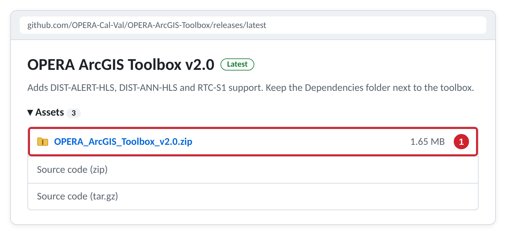
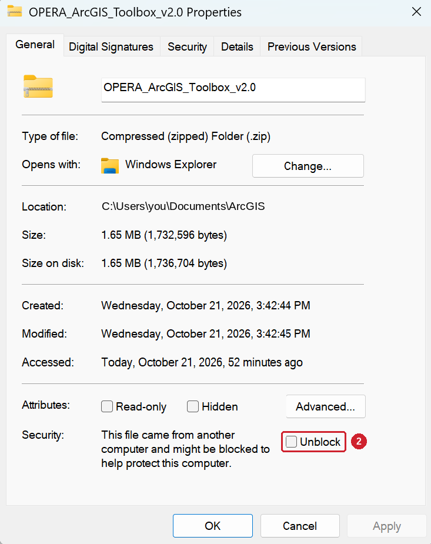
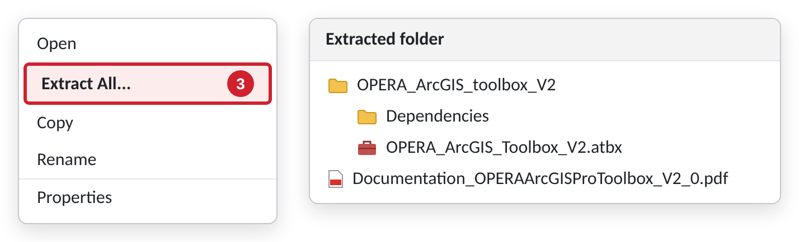
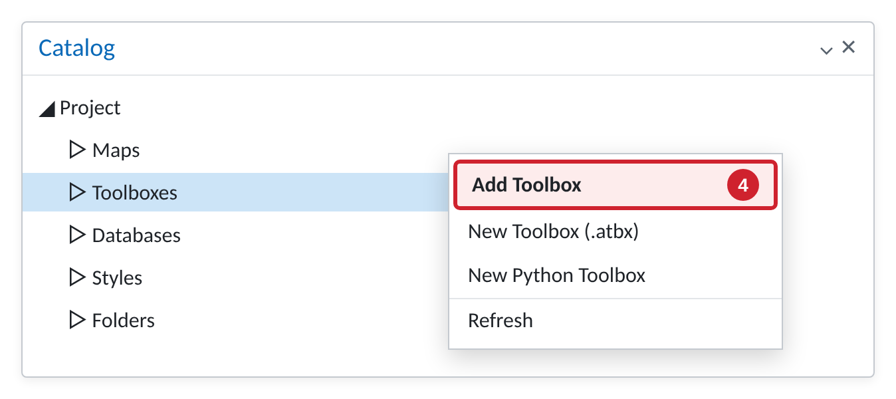
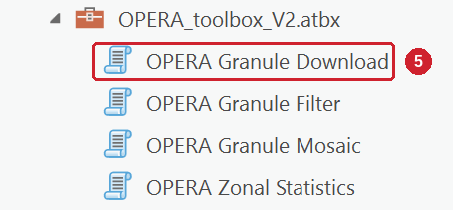
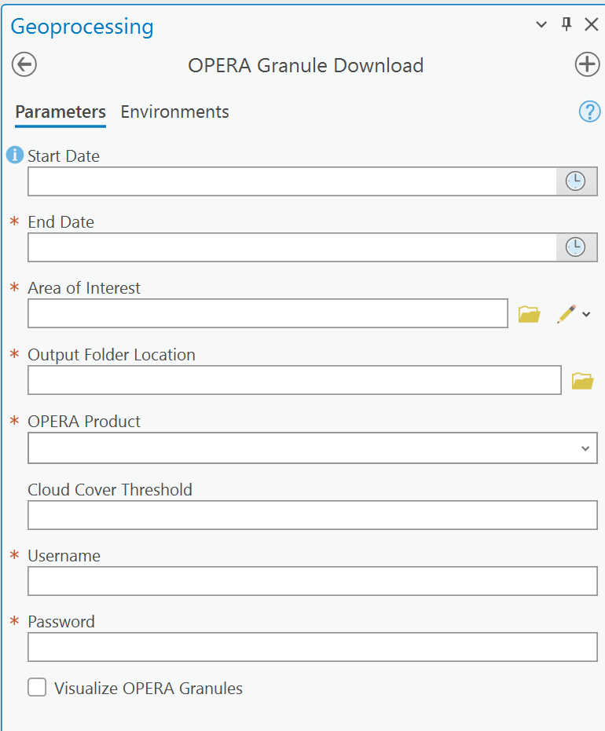

# OPERA ArcGIS Pro Toolbox

  
  
  

## Overview

The OPERA ArcGIS Pro Toolbox lets you download and analyze OPERA surface water (DSWx), surface disturbance (DIST) and radar backscatter (RTC) products directly in ArcGIS Pro. It contains four geoprocessing tools:

| Tool | What it does |
|---|---|
| **OPERA Granule Download** | Downloads DSWx-HLS, DSWx-S1, DIST-ALERT-HLS, DIST-ANN-HLS and RTC-S1 granules from PO.DAAC, LP DAAC and ASF DAAC. |
| **OPERA Granule Filter** | Filters downloaded granules, or granules in the Contents pane, by date range and area of interest. |
| **OPERA Granule Mosaic** | Composites and mosaics DSWx-HLS and DSWx-S1 granules using your land cover priorities. |
| **OPERA Zonal Statistics** | Calculates pixel count, area and percent area for each class within an area of interest. |

📄 For full details on each tool, see the **[Toolbox Documentation (PDF)](Documentation_OPERAArcGISProToolbox_V2_0.pdf)** ([direct download](https://github.com/OPERA-Cal-Val/OPERA-ArcGIS-Toolbox/raw/main/Documentation_OPERAArcGISProToolbox_V2_0.pdf)).

🎥 [Video tutorials](https://www.youtube.com/playlist?list=PLKWlaxzCh8uLAtuqFMQtjbZxqhKI_9fPR) are also available. *These were made for version 1 of the toolbox, which did not include the DIST-ALERT or RTC products.*

## Installation

> [!IMPORTANT]
> The toolbox needs the `Dependencies` folder (color ramp and symbology files) to run. Keep it in the same location relative to the toolbox file.

### Step 1: Download the latest release

On this page, click **Releases** in the right sidebar (or go to the [latest release](https://github.com/OPERA-Cal-Val/OPERA-ArcGIS-Toolbox/releases/latest)). Under **Assets**, click `OPERA_ArcGIS_Toolbox_v2.0.zip`.

### Step 2: Unblock the ZIP file (Windows)

Move the ZIP to a permanent folder, such as `Documents\ArcGIS`. Right-click it, choose **Properties**, check **Unblock**, and click **OK**. This prevents security errors when the tools run.

### Step 3: Extract the ZIP file

Right-click the ZIP and choose **Extract All**. Keep the extracted folder together; don't move the toolbox file away from the `Dependencies` folder.

### Step 4: Add the toolbox in ArcGIS Pro

Open an ArcGIS Pro project. In the **Catalog** pane, right-click **Toolboxes** and choose **Add Toolbox**. Browse to the extracted folder and select `OPERA_ArcGIS_Toolbox_V2.atbx`.

> [!TIP]
> To make the toolbox available in every project, right-click it in the Catalog pane and choose **Add To Favorites**.

### Step 5: Open a tool

Expand the toolbox in the Catalog pane to see the four tools. Double-click a tool to open it in the **Geoprocessing** pane.

## License

This project is licensed under the [Apache License 2.0](LICENSE).
